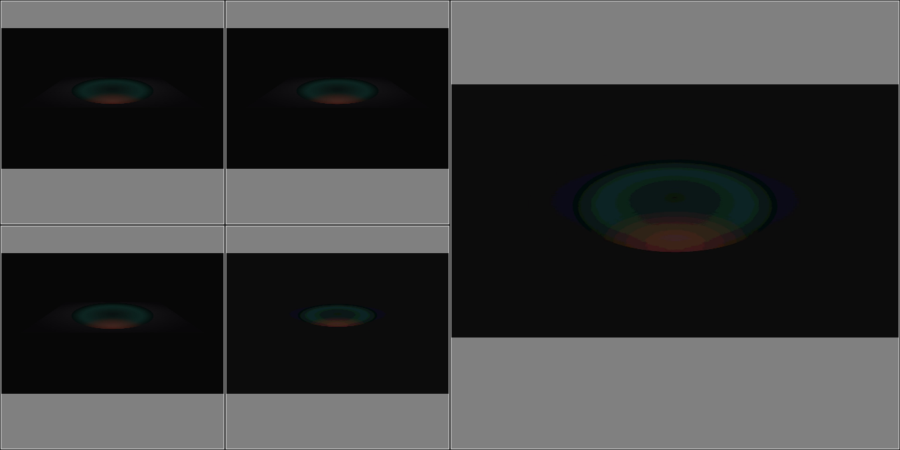
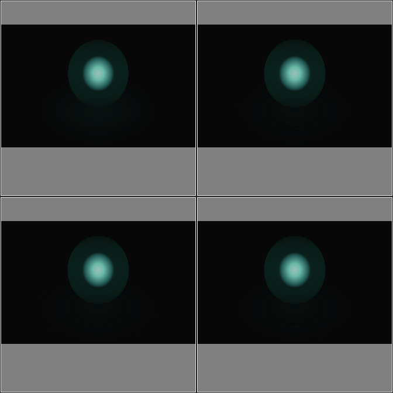

# dsh-pf-stream

**中文** | [English](README.en.md)

DeepSeek Harness（DSH）视频感知插件。模型用一个工具即可「看」本地视频：

- **连续事件** → 自适应流式采样。运动时按位移积分抽低 token 过程单元；停稳与顿挫波峰时定格高清焦点单元。
- **可疑时间点** → 确定性检视。能力：元数据探测、指定时间戳抽帧、均匀切片、局部 RoI 放大复核。

全部画布对齐 DeepSeek-V4.1-Flash 视觉编码管线：42px 超像素网格，计费 `r×(c+1)+2`。四种形态计费均 ≤530 token，满足单图 1024 token 上限。服务端按画布原始分辨率计量。

## 能力路由

一个主工具 `dsh-pf-stream`，统一 `intent.action` 路由：

| action | 引擎 | 用途 |
| --- | --- | --- |
| `pf_stream`（默认） | 动态流式采样 | 运动中抽 336² 过程单元（P）；停稳/波峰定格 672² 焦点单元（F）。施密特四状态机 + 双层自适应调节（意图基准 + 内容自闭环 R1-R4） |
| `timestamps` | 确定性检视 | 指定时间戳单帧/组合高清检视，支持 `roi_hint` 局部放大 |
| `uniform` | 确定性检视 | 固定步长或目标帧数均匀切片 |
| `probe` | 确定性检视 | 仅元数据（显示宽高/旋转/末帧 PTS/流摘要），零视觉 token |

## 安装

### 1. 安装插件

- 在 DSH 插件管理器中搜索 `dsh-pf-stream`，安装最新版本。
- 或直接对智能体说「安装插件 dsh-pf-stream」，智能体经 plugin_manager 完成同一流程。

安装由宿主执行：宿主经 pnpm 安装包，读取 `cordis.patch.yml` 挂载插件。peer 依赖 `@deepseek-ai/cordis` 与 `@deepseek-ai/schemastery` 由宿主运行时解析；运行时直接依赖仅 `pngjs`，画布 PNG 编码参数固定，输出字节幂等。

### 2. 准备 ffmpeg 与 ffprobe

任选一种安装方式：

```bash
winget install Gyan.FFmpeg   # Windows
brew install ffmpeg          # macOS
sudo apt install ffmpeg      # Debian / Ubuntu
```

也可从 [ffmpeg.org](https://ffmpeg.org/download.html) 下载解压，用环境变量指向 `bin` 目录。可执行文件定位顺序：插件配置 `ffmpegPath` / `ffprobePath` → `DSH_FFMPEG_PATH` / `FFMPEG_PATH` → `DSH_FFMPEG_DIR` → `~/.dsh/tools/ffmpeg/bin` → `~/.dsh/bin` → `PATH`。

### 3. 验证安装

安装成功后，模型侧出现工具 `dsh-pf-stream`。用任一本地视频探测元数据：

```json
{ "video_path": "D:/videos/demo.mp4", "intent": { "action": "probe" } }
```

返回显示宽高、时长、帧率，即安装成功。

## 使用

流式感知（问「画面里写了什么」）：

```json
{
  "video_path": "D:/videos/demo.mp4",
  "intent": { "action": "pf_stream", "focus": "detail", "mode": "dense" }
}
```

定点复核（流式结果中 12.9s 处发现文字）：

```json
{
  "video_path": "D:/videos/demo.mp4",
  "intent": {
    "action": "timestamps",
    "timestamps_ms": [12900],
    "roi_hint": { "x": 0.2, "y": 0.3, "w": 0.4, "h": 0.4 }
  }
}
```

顶层同时接受视频检视领域常见便捷字段：`start_time` / `end_time` / `timestamps` / `fps` / `interval` / `num_frames` / `crop` / `probe_only`。入口适配器将其归一化为标准 `intent` 结构。

## 返回内容

每次调用返回一个或多个画布包：

- **PNG 画布**：四形态之一（见下表）。单元间双色隔离线阻断相邻边缘特征串扰；可选超像素角标渲染单元编号。画布 PNG 同时作为图像内容块进入模型上下文（单次调用至多 `maxImagesPerCall` 张）。
- **结构化元数据**：`packet_id`、每单元 PTS、token 网格 bbox、源采样 bbox、双载体 SHA-256。
- **时序提示行**：模型可读的 P/F 单元时间轴（如 `[Packet #42 | Anchor: #105 | #101(P, 12.1s, Left-Top) → …]`）。

会话级能力：

- 意图跨调用持久化。
- 流式游标续窗：同视频下次调用从上次位置继续。
- 两级历史引用：热区最近 2 包整条带复用；冷区至多 4 个 F 锚点独立载体复用。
- Epoch Compaction：默认 6 包窗口批量热转冷，保持多轮对话 Prefix KV-Cache 前缀稳定。

## 画布与计费

| 形态 | 布局 | Token |
| --- | --- | --- |
| `FORM_1_STANDARD_STRIP` | 4P + 1F，1344×672 | 530 |
| `FORM_2_COMPACT_4P` | 4P，672×672 | 274 |
| `FORM_3_COMPACT_1F` | 1F，672×672 | 274 |
| `FORM_4_PARTIAL_STRIP` | 1-3P + 1F，1344×672 | 530 |

## 画布样例

`FORM_1` 标准条带：左半 4 个过程单元（P），右半 1 个焦点单元（F）。



`FORM_2` 纯过程：4 个过程单元。



`FORM_3` 单焦点：`roi_hint` 局部放大检视。


## 配置

| 配置项 | 默认 | 说明 |
| --- | --- | --- |
| `renderVisualId` | `true` | 单元左上角超像素反色角标 |
| `maxPacketsPerCall` | `64` | 单次调用返回包数上限 |
| `maxImagesPerCall` | `20` | 单次调用回传图像上限（宿主单条消息图像上限 20） |
| `maxTokensBudgetPerCall` | `65536` | 单次调用视觉 token 预算 |
| `maxRequestBytes` | `56 MiB` | 请求字节软水位（Base64 后口径） |
| `maxColdRefs` | `4` | 冷区引用上限 |
| `defaultStreamWindowMs` | `10000` | `pts_window` 缺省时窗口长度（毫秒） |
| `streamWorkMaxEdge` | `2048` | 流式解码工作分辨率长边上限（定点检视恒全分辨率） |
| `epochCompactionWindow` | `6` | 热转冷批量收敛窗口（包数） |
| `meteringProfile.imageCountTiersEnabled` | `false` | ≥15 图单边 4096px 规则门控 |

## 测试

```bash
pnpm test        # boundary（纯逻辑）+ e2e（fixture 驱动），20 项边界用例
pnpm run build   # TypeScript 编译
pnpm verify:host # 宿主契约自检（Schema 形状/关键字子集/依赖边界）
```

## 发布

npm 发布由 GitHub Actions 自动执行。流程与版本策略见 [docs/发布规范.md](docs/发布规范.md)。

## 许可证

Apache-2.0。
